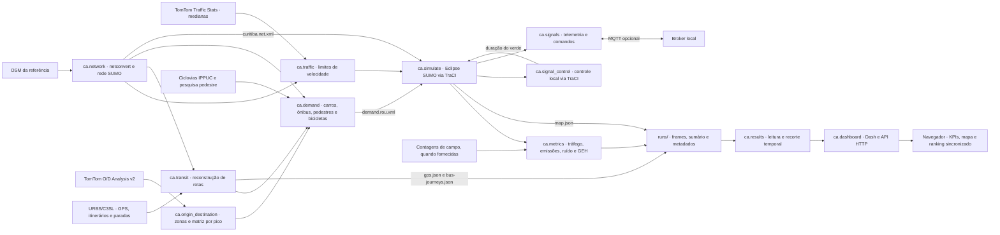
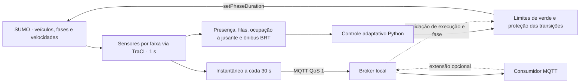

# Arquitetura do cenário de referência

O comando `run` busca velocidades medianas do Traffic Stats e a Flow Matrix do O/D Analysis v2 para o último mês civil completo. Prepara a URBS e simula os dois picos do enunciado enquanto serve o Dash. A coleta, uma simulação por data (`simulate`) e a leitura de execuções salvas (`serve`) também podem ser feitas separadamente. O simulador, o Dash e a API HTTP compartilham os arquivos JSON e JSONL em `runs/`.



## Fluxo de execução

No fluxo mensal, `ca.monthly` valida as datas e horários locais do relatório, reaproveita ou inicia uma análise de área no Traffic Stats. O GeoJSON também pode ser importado. `ca.origin_destination` divide o recorte em uma grade de 3 × 3 zonas e consulta a Flow Matrix de veículos de passeio no mesmo mês e nos dois picos de segunda a sexta. As análises são identificadas pelo nome derivado dos parâmetros, retomadas quando necessário e armazenadas em `data/cache/tomtom/`. A URBS fornece GPS dos dois picos de um mesmo dia útil. A seleção usa o campo `DTHR` da telemetria, incluindo o arquivo de veículos publicado no dia seguinte.

O resultado O/D contém proporções amostrais. O leitor conserva os registros em que a zona via coincide com a zona de destino, garantindo uma contribuição por viagem, e preserva a indicação de origem e destino externos. `ca.demand` associa origens e destinos internos à zona, entradas e saídas a trechos direcionais que cruzam o limite do recorte. Sorteia pares conforme o peso representável e escolhe uma rota conectada na malha. O simulador registra o número de pares e o percentual do peso com rota viável. As taxas configuradas definem o volume absoluto de partidas. `--sem-od` volta à distribuição estimada pela malha. [Formato do resultado Flow Matrix v2](https://docs.tomtom.com/od-analysis/documentation/v2/analysis/flow-matrix-analysis/analysis-trips-result)

Com `run --offline`, o cenário usa o GeoJSON de 1 e 2 de agosto de 2024 da pasta de referência. Para cada trecho TomTom, o peso de origem é o limite da via dividido por `averageSpeed`, limitado ao intervalo de 1 a 10. Para uma aresta SUMO associada a vários trechos no mesmo sentido, o simulador usa a média desses pesos. As rotas dos ônibus vêm do cache da URBS. Os metadados registram as datas de ambas as fontes.

1. **Preparar os dados.** [`main()`](../ca/__main__.py) recebe `python -m ca <comando>` e lê [`config/curitiba.json`](../config/curitiba.json). `network` converte o OSM em `data/cache/network/curitiba.net.xml`. `urbs`, `tomtom` e `ippuc` atualizam seus caches em `data/cache/`. O histórico TomTom e o OSM vêm da pasta de referência.
2. **Montar a janela.** `simulate` chama `scenario()` no mesmo arquivo. Ele abre `runs/<id>/`, resolve data e horário e carrega a rede. [`demand_observations()`](../ca/traffic.py) associa velocidades a trechos da rede. [`match_buses()`](../ca/transit.py) converte os episódios de GPS aceitos em rotas dirigíveis. `scenario()` grava os dados para rastreamento em `bus-journeys.json` e `gps.json`.
3. **Gerar as entradas SUMO.** [`build_routes()`](../ca/demand.py) reúne as rotas de carros, ônibus e bicicletas e os trajetos a pé em `demand.rou.xml`. [`setup_sumo()`](../ca/simulate.py) gera `baseline.sumocfg`, que aponta para a rede, a demanda e o plano semafórico adicional quando informado.
4. **Simular e publicar resultados.** `run_sumo()` avança o SUMO via TraCI em passos de 1 s. As posições de carros e ônibus dentro do recorte são amostradas a cada 2 s e publicadas em `positions/<fim_do_bloco>.json`. Um frame JSONL a cada 30 s alimenta os indicadores, as estimativas acústicas e as emissões calculadas em [`ca.metrics`](../ca/metrics.py). `scenario()` calcula o agregado da janela completa e grava `summary.json`. Quando habilitado, o MQTT publica observações dos sensores semafóricos.
5. **Exibir no navegador.** `serve` chama [`create_app()`](../ca/dashboard.py). A cada 2,5 s, ou quando o usuário muda a execução ou o modal, os callbacks leem os resultados via [`RunResults`](../ca/results.py). A análise cobre o pico inteiro. No mapa de calor, os KPIs agregam os blocos completos até a posição da reprodução. O painel lê execuções salvas e acompanha novos blocos enquanto o SUMO está rodando.

## Reprodução do tráfego

O SUMO soma um veículo-segundo por carro ou ônibus ativo dentro do recorte a cada passo. A grade cobre o quadrilátero com células de aproximadamente 100 m. O Dash soma a ocupação desde o início do pico e exibe o total em veículos-minuto por célula. A reprodução adiciona uma fração da ocupação do bloco em andamento e suaviza as cores entre células. A escala logarítmica é fixa e atinge a cor mais escura a partir de 1.000 veículos-minuto. O ranking **Maior trânsito** ordena os mesmos valores usados nas células do mapa. Clicar num item destaca o contorno exato da célula. A camada **Semáforos** mostra os cruzamentos sinalizados identificados na rede SUMO.

Na execução mensal, `ca.traffic` usa o campo `medianSpeed` do GeoJSON para a combinação de mês e pico. Quando mais de um segmento da TomTom corresponde a uma aresta dirigida, usa-se a mediana das velocidades dos segmentos. O TraCI limita a velocidade desejada dos automóveis nas arestas cobertas, com piso de 1 km/h para medianas iguais a zero, e restaura a velocidade máxima original ao sair delas. A malha, as interações e os semáforos também influenciam a velocidade simulada. O volume de partidas vem das taxas estimadas na configuração e o GEH usa contagens independentes.

## Camadas de veículos no mapa

| Camada | Origem | Instante exibido |
|---|---|---|
| **Carros simulados** · pontos verdes | Coordenadas que o SUMO calculou para cada carro presente no quadrilátero, com identificação do agente. | Instante da reprodução, interpolado entre amostras consecutivas de 2 s. Execuções antigas usam os pontos gravados nos blocos de 30 s. |
| **Ônibus simulados** · quadrados azuis | Coordenadas que o SUMO calculou para os ônibus ativos dentro da área. As rotas foram reconstruídas a partir de GPS real da URBS, considerando a rede e os itinerários. | Mesmo intervalo de amostragem e interpolação dos carros. |
| **GPS URBS** · círculos roxos | Coordenadas gravadas no arquivo histórico do C3SL para os episódios aceitos. O painel usa a versão amostrada em `gps.json`. Clique no nome da camada na legenda para exibi-la. | Última amostra disponível por veículo e linha nos 30 s anteriores ao fim desse mesmo bloco, dentro do intervalo selecionado. |

Para ônibus, as camadas permitem comparar a posição produzida pelo modelo com a registrada em campo. Os pontos podem aparecer em lugares diferentes porque o SUMO calcula o deslocamento a partir da rota e das condições simuladas, e porque cada observação do GPS tem seu próprio horário. A identificação do veículo observado, da linha e do agente no SUMO está em `bus-journeys.json`.

**Reproduzir** avança 15 s de simulação por segundo na velocidade de 1×. O navegador solicita uma atualização a cada 100 ms. O mapa interpola somente entre posições do mesmo veículo. Deslocamentos incompatíveis com a velocidade esperada são mostrados como saltos. O Dash carrega sob demanda os arquivos de posições próximos do instante exibido. O seletor permite acelerar para 2×, 4× e 8×. Use **Pausar** para examinar um horário, **Reiniciar** para voltar ao início ou a barra para saltar de minuto em minuto. Nas camadas de cruzamentos, as cores resumem o pico.

## Mobilidade ativa

O Marco 3 pede modelar travessias de pedestres no Calçadão da XV de Novembro e faixas exclusivas para ciclistas. `ca.demand` posiciona os pedestres nas calçadas ligadas às travessias mapeadas da Rua XV e estima as partidas com base na pesquisa local e na fração de travessia configurada. O TraCI conta entradas nessas faixas. Rotas de bicicleta usam conexões destinadas ao modal na rede SUMO. A proximidade de infraestrutura operacional do IPPUC aumenta o peso dessas rotas. O painel mostra travessias por cruzamento e a diferença entre partidas de bicicleta programadas e viagens concluídas. [Memorial de cálculo](memorial.md)

## TomTom ao vivo

O modo **TomTom ao vivo** usa a geometria e as observações retornadas pelo Traffic Flow. O servidor consulta 16 pontos nos corredores e usa uma captura em cache compartilhada entre sessões. Enquanto essa opção está selecionada, o navegador verifica a idade da captura a cada minuto e o servidor coleta novamente quando ela completa 15 minutos. A atualização manual usa um intervalo mínimo de 60 s. Em caso de falha, o painel informa o erro e conserva o horário da última captura disponível.

`simulate --live-flow` usa somente as observações capturadas dentro da janela do cenário e associadas à malha. As velocidades atuais e livres ponderam a demanda dos carros nos trechos cobertos. Trechos sem cobertura usam os pesos da malha e a quantidade de partidas é estimada. Com `--urbs-date`, a demanda de ônibus usa GPS arquivado no mesmo horário local. A data de origem do GPS e a captura TomTom aplicada ficam registradas em `metadata.json`.

## Módulos

| Módulo | Contrato e responsabilidade |
|---|---|
| `ca.sources` | URBS/C3SL JSON comprimido em XZ, TomTom Flow JSON autenticado e GeoCuritiba. Normalização, datas das observações, auditoria e cache local. |
| `ca.network` | Conversão OSM, topologia SUMO, índice espacial para associação de coordenadas WGS84 a trechos, rede a pé e mapa. |
| `ca.traffic` | Converte velocidades históricas e contemporâneas em `traffic-targets.json`, com identificação do trecho, fonte e alvos. |
| `ca.origin_destination` | Monta zonas WGS84, solicita ou recupera a matriz TomTom v2 e valida as proporções por pico. |
| `ca.transit` | Emparelha GPS com a rede e itinerários por linha. Gera viagens com tipo `bus`, posição de partida e chegada, e paradas inferidas. |
| `ca.demand` | Gera `demand.rou.xml` ordenado por instante, com carros, ônibus, pedestres e bicicletas. |
| `ca.simulate` e `ca.metrics` | Executam passo SUMO, integram medidas de fluxo, acústica, filas e emissões e calculam GEH com observações de campo. |
| `ca.results` e `ca.dashboard` | Leitura incremental de frames completos, agregação temporal e visualização cliente/servidor. |
| `ca.signal_control` | Controle por presença, fila, pressão local e chegada de pelotões. Inclui prioridade aos movimentos BRT e um modo seletivo. |
| `ca.learning` | Política aprendida, atualização online por ciclo e regra de pressão com ajustes compensados. Valida e carrega os modelos por pico. |
| `ca.feedback` | Duração do verde em malha fechada a partir da demanda, da ocupação das saídas e dos movimentos BRT. |
| `ca.signals` | Publicação MQTT dos sensores e recepção opcional de extensões de verde. |
| `ca.experiments` | Reexecução pareada com os mesmos arquivos do cenário fixo e confirmação por SHA-256. |

## Arquivos e API HTTP

Os JSON usam UTF-8 e têm `schema_version: "1.0"` e `kind`. Os instantes de integração são ISO 8601 UTC com `Z`. As janelas usam `[start_s, end_s)` em segundos desde o início modelado. O `timestamp` do frame representa o fim do bloco. Coordenadas usam `[longitude, latitude]` WGS84. Campos ausentes de uma aproximação em um frame representam atividade zero nesse bloco. Um KPI sem denominador ou LAeq sem energia fica `null`.

| Recurso | Persistência | Conteúdo |
|---|---|---|
| `/api/v1/runs` | `runs/*/status.json` e `metadata.json` | Execuções, estado de preparação/simulação, janela e fontes. |
| `/api/v1/runs/{id}/metadata` | `metadata.json` | Data, demanda e rede, recorte, premissas, fontes e medições importadas. `demand.origin_destination` registra a análise O/D e a cobertura de rotas quando a matriz é usada. `queue_measurement` identifica o método de filas. |
| `/api/v1/runs/{id}/map` | `map.json` | Rede, cruzamentos, receptores, faixas, sensores e dimensões da grade em `traffic_grid`. `car_positions` indica que a execução registra posições individuais dos carros. |
| `/api/v1/runs/{id}/frames?after=0` | `frames.jsonl` | JSONL com eventos `simulation.frame`. `traffic_cells` associa veículos-segundo ao índice `linha × colunas + coluna`, contado desde o sudoeste. `cars` e `buses` guardam o ID SUMO e as coordenadas WGS84 no fim do bloco. `buses` inclui a linha. Execuções anteriores podem omitir `cars`. `after` é o número de frames já consumidos. |
| `/api/v1/runs/{id}/window?start_s=0&end_s=1800` | Derivado dos frames | KPIs, massas e energias dos blocos completos contidos no intervalo. `duration_s` informa o tempo efetivamente coberto. |
| `/api/v1/runs/{id}/summary` | `summary.json` | Agregado completo, volumes comparados por GEH, pares de velocidade e contagem de viagens concluídas. |
| `/api/v1/runs/{id}/comparison` | Execução dinâmica e repetição fixa com SHA-256 iguais | Indicadores do pico As-Is e To-Be, incluindo atraso das viagens BRT comuns e LAeq dos receptores comuns. |
| `/api/v1/runs/{id}/gps` | `gps.json` | Amostra de posições observadas por `[t_s, lon, lat, veiculo, linha]`. |
| `/api/v1/runs/{id}/bus-journeys` | `bus-journeys.json` | Linha, veículo, extremos observados em segundos, cobertura e erro geométrico de cada associação. |
| `/api/v1/runs/{id}/traffic-targets` | `traffic-targets.json` | Velocidade de referência por trecho SUMO e registros TomTom associados à janela. |
| `/api/v1/tomtom/latest` | `data/cache/tomtom/flow-*.json` | Instante, geometria, velocidades, tempos e confiança da captura mais recente. |
| `/api/v1/urbs/coverage` | `data/cache/urbs/coverage-*.json` | Datas e contagens de GPS por arquivo auditado. |

O registro de frames é append-only por execução. A produção publica um bloco de cada vez e aproveita a publicação atômica para arquivos inteiros. A UI consulta o servidor a cada 2,5 s em tempo de parede. Um segundo de simulação tem duração variável na máquina. O esquema de integração define sensor, frame, janela, amostra TomTom, jornada, comando e comparação semafórica. [Contrato JSON](../schemas/interop.schema.json)

## Entradas de campo

Use `--counts contagens.json`, com IDs de trecho da rede gerada. O identificador corresponde a uma aproximação dirigida em `curitiba.net.xml`. `mode` aceita `cars`, `buses`, `bicycles` ou `motor` para carros e ônibus juntos. Verifique sentido, modalidade e o ponto de medida das contagens do IPPUC ou de campo. Cada intervalo contido no cenário é comparado com a saída simulada do respectivo trecho. Exemplo de formato, com valores ilustrativos:

```json
{
  "counts": [
    {"edge_id": "697619813#2", "mode": "cars", "start": "2026-11-16T17:00:00-03:00", "end": "2026-11-16T17:15:00-03:00", "vehicles": 48, "source": "ID e origem da contagem de campo"}
  ]
}
```

Use `--noise medicoes.json` com `measurement_kind` igual a `residual` ou `total`. Registre o ponto, instrumento e calibração, condições e método de medição no laudo indicado pelo campo `source`. Exemplo de formato, com valores ilustrativos:

```json
{
  "measurements": [
    {"intersection_id": "679715044", "measurement_kind": "residual", "start": "2026-11-16T17:00:00-03:00", "end": "2026-11-16T17:15:00-03:00", "laeq_dba": 51.3, "source": "Identificação do laudo de campo"}
  ]
}
```

Com uma amostra representativa de contagens, ajuste `--car-scale` e as premissas de OD em `ca.demand`, compare os `summary.json` e valide com intervalos e observações reservados. O objetivo de validação do trabalho é GEH menor que 5 em pelo menos 85% dos casos. O resultado das medições acústicas com janela idêntica aparece ao lado da estimativa no painel.

## Sinalização e sensoriamento virtual



| Sensor virtual | Posição ou área | Sinal usado |
| --- | --- | --- |
| Presença MQTT por faixa veicular | 15 m antes da retenção | Estado ocupado/livre e velocidade do veículo mais próximo |
| Aproximação para controle | Até 70 m antes da retenção | Contagem de veículos e contagem abaixo de 2 m/s |
| Chegada antecipada de pelotão | Entre 70 e 160 m antes da retenção | Carros e ônibus a partir de 4 m/s com chegada estimada em até 15 s |
| Ocupação a jusante | Faixa de saída | Veículos nos primeiros 18 m ou abaixo de 2 m/s |
| Prioridade de ônibus | Últimos 50 m da faixa de entrada | Linha URBS e índice do próximo movimento sinalizado via `getNextTLS` |
| CO₂ instantâneo e fila | Até 100 m para CO₂ e faixas conectadas para fila | g/s e comprimento em metros |
| Receptor acústico | 9 m deslocado do nó, a 1,5 m de altura | Energia somada das fontes veiculares em até 100 m |

O programa do SUMO define a sequência de fases. O controlador altera a duração de verdes veiculares elegíveis, preservando fases com amarelo, vermelho integral ou verde de travessia de pedestres ou de faixa de entrada exclusiva para bicicletas. Por presença, fila ou pressão, a referência para o verde mínimo é 60% do nominal ou 12 s, o que for menor. No modo seletivo, um verde concorrente dura pelo menos 65% do nominal e 12 s antes de qualquer redução. Cada estratégia mantém um limite máximo de verde. A prioridade BRT usa o movimento real sinalizado do ônibus e beneficia o verde que o atende ou antecipa o fim de um verde concorrente dentro dos limites. A lista de linhas é configurável. Um ônibus parado numa parada programada fica fora da detecção de prioridade. [Categorias URBS](https://www.urbs.curitiba.pr.gov.br/portal/wp-content/uploads/2026/06/linhas_que_aceitam_urbanas.pdf)

O perfil `--control by-peak` resolve a estratégia no início da janela usando `signal_control_by_peak` em `config/curitiba.json`. Os metadados registram a opção solicitada e a estratégia aplicada. O perfil pode ser usado na geração de demanda ou em uma repetição pareada.

`run` e `simulate` leem `default_signal_plan` para instalar a Onda Verde da Kennedy. `--signals` permite usar outro plano. A repetição mantém o plano registrado na execução de origem e admite um arquivo adicional indicado no comando. `--control ml` usa o modelo correspondente ao pico. Ao longo de cada ciclo, um verde pode ganhar tempo e outro perde o mesmo valor. Programas de coordenação carregados como adicionais ficam fora dos ajustes de `ml` e `cycle-pressure`. [Método e experimento](controle-aprendido.md)

`--control ml-online` acrescenta aprendizagem durante a execução e usa as mesmas restrições de verde e coordenação. Os frames trazem os contadores de atualização em `online_control`. A evidência ponderada por recência é gravada junto aos resultados. [Método e comparação online](controle-aprendido.md#aprendizado-online)

`--control feedback` e `--control feedback-transit` observam as faixas de saída pela trajetória dos veículos no TraCI e usam o espaço disponível para autorizar a prioridade BRT. O primeiro também reage a verdes ociosos e a saídas bloqueadas. O SUMO realimenta as decisões a partir da ação aplicada e os programas coordenados ficam fora desse ajuste. [Malha fechada e resultados](malha-fechada.md)

Para usar um broker local, execute `mosquitto -c config/mosquitto.conf` e passe `--mqtt 127.0.0.1:1883` ao simulador. Com `--control mqtt-adaptive`, dois clientes trocam observações e decisões semafóricas em lotes nos tópicos `adaptive/observations` e `adaptive/decisions` de cada execução. [Fluxo, limites das ações e ensaio nos dois picos](quadrilatero-mqtt.md)

Nos demais modos, a telemetria usa `curitiba/v1/{run_id}/intersections/{intersection_id}/sensors` com QoS 1, sem retenção. A chave de deduplicação é `(run_id, intersection_id, timestamp)`. O pacote inclui o instante simulado `observed_s`. Cada entrada em `signals` contém o índice, o estado das lâmpadas e o próximo instante de mudança em segundos simulados.

Com `--mqtt-control`, um cliente local pode publicar em `curitiba/v1/{run_id}/control/extend-green` com QoS 1 e sem retenção. O comando usa o mesmo `timestamp` e `observed_s` de uma telemetria recente e copia a fase e o instante de troca do sinal alvo. Uma extensão de 1 a 5 s pode ser aplicada uma vez por ocorrência de fase elegível, respeitando o limite de verde. A execução ignora observações expiradas, duplicatas e solicitações incompatíveis com a fase ou previsão de troca. O controle autônomo roda no passo de 1 s do TraCI.

```json
{
  "schema_version": "1.0",
  "kind": "signal.extend_green",
  "timestamp": "2026-07-31T09:31:00Z",
  "run_id": "cenario-teste",
  "signal_id": "324272059",
  "phase_index": 0,
  "observed_s": 60,
  "next_switch_s": 72,
  "seconds": 3
}
```

As geometrias e IDs de cruzamentos estão em `map.json`, as linhas dos ônibus em `bus-journeys.json` e os contratos em [interop.schema.json](../schemas/interop.schema.json). Em um plano medido, `--signals` recebe um arquivo adicional SUMO com `tlLogic` por ID.

## Fontes e confidencialidade

As chaves da TomTom permanecem em `.env` ou nas variáveis de ambiente `TOMTOM_STATS_API_KEY` e `TOMTOM_API_KEY`. Cada chave é enviada ao endpoint da TomTom para seu respectivo produto. `.env`, caches e execuções são ignorados pelo controle de versão. A API padrão escuta em `127.0.0.1` e inclui identificadores de frota já publicados no feed de transporte. Fontes, premissas e fórmulas também estão em [Memorial de cálculo](memorial.md).
