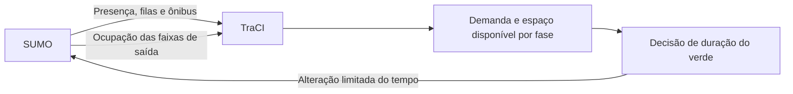

# Controle em malha fechada sobre a Onda Verde

A Onda Verde da Kennedy é a referência fixa da simulação. Os modos `feedback` e `feedback-transit` usam a mesma programação inicial. O SUMO fornece as observações de tráfego a cada segundo simulado. O TraCI agenda as decisões a cada 3 s nos verdes elegíveis e reavalia o trânsito após cada ação.



O controlador estima a ocupação dividindo o comprimento dos veículos observados e seus espaçamentos nominais pelo comprimento da faixa de saída. A prioridade de um BRT usa o próximo movimento informado pelo TraCI e exige ao menos uma faixa de saída abaixo de 72% de ocupação estimada. A demanda de cada aproximação combina veículos lentos e veículos que se aproximam. A pressão pondera essa demanda pelo espaço disponível nas saídas da fase. Essa é uma adaptação da ideia de considerar capacidade finita no controle por pressão. [Grégoire et al., controle por pressão com capacidade finita](https://doi.org/10.1109/TCNS.2014.2378871)

- **`feedback`** pode encerrar um verde pouco utilizado, antecipar o próximo verde para um BRT com saída disponível ou aliviar uma aproximação bloqueada quando a próxima fase tem demanda atendível. Um BRT atendido pode prolongar o verde em até 6 s.
- **`feedback-transit`** intervém para priorizar o BRT. A extensão ocorre perto do fim previsto do verde e depende do espaço de saída. A antecipação depende de a próxima fase atender o ônibus e de a fase atual ter pouca demanda atendível em relação à próxima.

Os oito programas coordenados ficam fora da atuação. A regra usa a sequência de fases existente e preserva transições e verdes de travessia protegidos. A realimentação pode afetar o trânsito que chega aos sinais coordenados pelas vias adjacentes, por isso a avaliação acompanha também a fila máxima na Kennedy.

## Comparação

As alternativas foram avaliadas nos picos de 6h30–9h e 17h–19h, com as mesmas rotas, velocidades, malha, Onda Verde e semente 42 das execuções anteriores de julho de 2026. O perfil `by-peak` foi incluído como referência adicional de controle dinâmico. Para comparar o conjunto prioritário, calculou-se a média das variações percentuais no atraso de carros e ônibus, velocidade, fila média e atraso BRT nas mesmas viagens concluídas pelos quatro cenários. Filas máximas, viagens concluídas, teletransportes e emissões mostram os compromissos de cada alternativa.

**`feedback` obteve a maior pontuação nos dois picos.** Frente à Onda Verde, reduziu o atraso de carros e ônibus em 6,1% e 4,5%, a fila média da rede em 4,6% e 5,0%, e a maior fila nos oito sinais da Kennedy em 17,2% e 31,4%, de manhã e à tarde. As cinco emissões medidas caíram nos dois períodos.

A maior fila da rede subiu de 338,2 para 390,2 m pela manhã. O ponto de maior fila passou de Silva Jardim com Alferes Poli para Sete de Setembro com Alferes Poli. À tarde, a fila máxima da rede subiu de 260,4 para 268,6 m na canaleta BRT com João Negrão. Os teletransportes passaram de 138 para 160 pela manhã e de 77 para 86 à tarde. A escolha favorece o conjunto de indicadores prioritários dentro das duas janelas avaliadas com uma semente.

### Resultados por pico

#### Manhã

A amostra BRT contém 157 viagens concluídas sem teletransporte nos quatro cenários. Os dois controladores novos verificaram a realimentação 76.945 e 125.241 vezes, respectivamente.

| Indicador | Onda Verde fixa | Filas e BRT | Prioridade BRT | Regras por pico anteriores |
| --- | ---: | ---: | ---: | ---: |
| Atraso médio de carros e ônibus (s) | 345,5 | 324,4 | 342,8 | 318,9 |
| Tempo médio de viagem (s) | 729,6 | 708,2 | 726,2 | 701,9 |
| Velocidade média da rede (km/h) | 13,05 | 13,31 | 13,29 | 13,27 |
| Fila média da rede (m) | 4,52 | 4,31 | 4,17 | 4,55 |
| Maior fila da rede (m) | 338,2 | 390,2 | 338,2 | 353,5 |
| Maior fila nos oito sinais da Kennedy (m) | 41,1 | 34,1 | 42,0 | 35,1 |
| Viagens motorizadas concluídas | 6.416 | 6.406 | 6.421 | 6.393 |
| Teletransportes | 138 | 160 | 128 | 169 |
| Atraso nas mesmas viagens BRT (s) | 994,0 | 846,8 | 964,0 | 825,9 |
| Viagens BRT concluídas | 204 | 205 | 194 | 187 |
| Travessias monitoradas | 666 | 666 | 666 | 666 |
| Viagens a pé concluídas | 656 | 656 | 656 | 656 |
| Espera média de pedestres (s) | 39,14 | 39,14 | 39,14 | 39,14 |
| Viagens de bicicleta concluídas | 80 | 80 | 80 | 80 |
| CO₂ (kg) | 20.019,6 | 19.673,2 | 19.408,6 | 19.676,3 |
| CO (kg) | 304,70 | 294,59 | 303,57 | 294,82 |
| NOₓ (kg) | 123,91 | 121,74 | 116,75 | 121,97 |
| HC (kg) | 9,007 | 8,796 | 8,445 | 8,833 |
| PMx (kg) | 3,534 | 3,461 | 3,299 | 3,474 |
| LAeq conjunto (dB(A)) | 67,47 | 67,42 | 67,37 | 67,31 |

#### Tarde

A amostra BRT contém 212 viagens concluídas sem teletransporte nos quatro cenários. Os dois controladores novos verificaram a realimentação 61.716 e 100.028 vezes, respectivamente.

| Indicador | Onda Verde fixa | Filas e BRT | Prioridade BRT | Regras por pico anteriores |
| --- | ---: | ---: | ---: | ---: |
| Atraso médio de carros e ônibus (s) | 330,5 | 315,7 | 324,3 | 325,5 |
| Tempo médio de viagem (s) | 730,0 | 715,7 | 723,8 | 725,9 |
| Velocidade média da rede (km/h) | 12,05 | 12,28 | 12,04 | 12,15 |
| Fila média da rede (m) | 4,19 | 3,98 | 4,11 | 4,06 |
| Maior fila da rede (m) | 260,4 | 268,6 | 277,6 | 267,2 |
| Maior fila nos oito sinais da Kennedy (m) | 50,5 | 34,7 | 50,5 | 57,6 |
| Viagens motorizadas concluídas | 6.001 | 6.012 | 5.962 | 6.010 |
| Teletransportes | 77 | 86 | 99 | 81 |
| Atraso nas mesmas viagens BRT (s) | 707,4 | 626,4 | 600,4 | 614,7 |
| Viagens BRT concluídas | 234 | 234 | 239 | 240 |
| Travessias monitoradas | 2.583 | 2.583 | 2.583 | 2.583 |
| Viagens a pé concluídas | 2.553 | 2.553 | 2.553 | 2.553 |
| Espera média de pedestres (s) | 39,48 | 39,68 | 39,55 | 39,52 |
| Viagens de bicicleta concluídas | 64 | 64 | 63 | 64 |
| CO₂ (kg) | 16.416,1 | 16.142,2 | 16.301,4 | 16.218,8 |
| CO (kg) | 296,23 | 286,92 | 299,80 | 294,22 |
| NOₓ (kg) | 91,22 | 89,85 | 89,19 | 89,28 |
| HC (kg) | 6,699 | 6,565 | 6,558 | 6,547 |
| PMx (kg) | 2,548 | 2,504 | 2,482 | 2,485 |
| LAeq conjunto (dB(A)) | 67,47 | 67,35 | 67,44 | 67,42 |

| Estratégia | Pontuação manhã | Pontuação tarde | Média |
| --- | ---: | ---: | ---: |
| feedback | 6,87 | 5,72 | 6,30 |
| feedback-transit | 3,30 | 4,70 | 4,00 |
| by-peak | 6,36 | 4,61 | 5,49 |

## Reprodução

```powershell
python -m ca run --month 2026-07 --control feedback
python -m ca run --month 2026-07 --control feedback-transit
```

Para repetir uma configuração com os mesmos dados do benchmark, use `replay` com a execução mensal original e `--signals config/signals/onda-verde-kennedy.add.xml`. [Referência e dados da Onda Verde](onda-verde.md)
